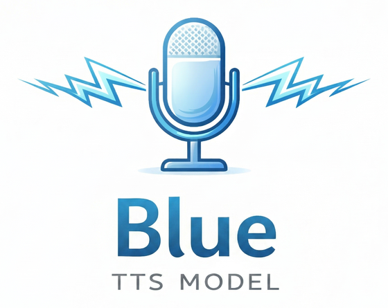

<p align="center">
  
</p>

<p align="center">
  <b>Multilingual text-to-speech on ONNX Runtime</b><br>
  Hebrew &middot; English &middot; Spanish &middot; Italian &middot; German &middot; Russian &middot; Yiddish
</p>

<p align="center">
  <a href="https://huggingface.co/spaces/notmax123/BlueV2"></a>
  &nbsp;
  <a href="https://bluetts.com/"></a>
</p>

---

## Quick start

```bash
git clone https://github.com/maxmelichov/BlueTTS.git
cd BlueTTS
uv sync
uv run hf download notmax123/BlueV3-onnx --include "onnx/*" "voices/*" "frontend/*" --local-dir ./bluev3_onnx
uv pip install ./bluev3_onnx/frontend/polyg2p-*.whl     # G2P for en / de / es / it (Linux x86-64, glibc >= 2.34)
```

```python
import soundfile as sf
from blue_onnx import BlueTTS

tts = BlueTTS(onnx_dir="bluev3_onnx/onnx", style_json="bluev3_onnx/voices/noa.json")
samples, sr = tts.synthesize("שלום, זהו מודל דיבור בעברית.", lang="he")
sf.write("out.wav", samples, sr)

samples, sr = tts.synthesize("Hello, this is BlueTTS.", lang="en")
```

The bundle sets the operating point itself (8 steps, CFG 4.0, speed 1.0, language tags on).
Numbers, dates, prices and codes are spoken as words automatically. Mix languages
inline with `<en>…</en>`:

```python
samples, sr = tts.synthesize("שלום לכולם, <en>welcome to the presentation</en>.", lang="he")
```

Hebrew grapheme-to-phoneme is [RenikudPlus](https://github.com/maxmelichov/RenikudPlus), with the
weights shipped in the bundle (`frontend/renikud/model.onnx`); English, German, Spanish, Italian
and Russian use polyg2p (its wheel in the bundle is for Linux x86-64); Yiddish uses the bundle's
`frontend/yi`. The bundle runs on `blue_onnx`; `blue_trt` does not
read it yet. Details: [Release bundles](src/blue_onnx/README.md#release-bundles).

## Documentation

| | |
|---|---|
| [`src/blue_onnx/`](src/blue_onnx/README.md) | **Inference API** — entry points, text normalization, language spans, accelerators |
| [`examples/`](examples/README.md) | Runnable scripts for every feature |
| [`exports/`](exports/README.md) | New voices, ONNX export, TensorRT engines |
| [`training/`](training/README.md) | Dataset prep and the three training stages |

## Install

Requires **Python 3.12+** and [uv](https://docs.astral.sh/uv/).

```bash
git clone https://github.com/maxmelichov/BlueTTS.git
cd BlueTTS
uv sync
```

Optional extras are documented per use case: [accelerators](src/blue_onnx/README.md#accelerators)
(OpenVINO, CUDA), [`--extra export`](exports/README.md) for voice/ONNX export, and
[`--extra tensorrt`](exports/README.md#build-tensorrt-engines).

## Models

**Current — BlueV3 `v3.0.0`** (checkpoint `701500`): the text-to-latent EMA at 700k plus 1,500 iterations
of FlowTTS-GRPO reinforcement learning ([arXiv 2606.23190](https://arxiv.org/abs/2606.23190)).

| | |
|---|---|
| [notmax123/BlueV3-onnx](https://huggingface.co/notmax123/BlueV3-onnx) | ONNX bundle: `onnx/` (the `blue_onnx` layout + `reference_encoder`), `voices/`, `frontend/` |
| [notmax123/BlueV3](https://huggingface.co/notmax123/BlueV3) | PyTorch checkpoints (text-to-latent `ckpt_step_701500.pt`, duration predictor), latent stats, config, voices |
| [notmax123/blue-codec](https://huggingface.co/notmax123/blue-codec) | the audio autoencoder, folder `bluev3_codec/` |

Languages: Hebrew, English, German, Spanish, Italian, Russian, Yiddish. Operating point: 8 Euler steps,
CFG 4.0, speed 1.0, language tags on.

```python
samples, sr = tts.synthesize("Привет, как дела?", lang="ru")
samples, sr = tts.synthesize("גוט מאָרגן, ווי גייט עס?", lang="yi")
```

**Voices.** 15 voice JSONs (LibriTTS-R speakers, CC BY 4.0) in [`voices/`](voices/) and in the bundle's
`voices/` ([list](examples/voices.md)): female `maya`,
`noa`, `lily`, `tamar`, `shira`, `yael`, `emma`, `sara`; male `adam`, `daniel`, `david`, `jonathan`, `ethan`,
`michael`, `ariel`. A voice JSON is valid only for the checkpoint it was exported from; voices of earlier
releases do not work with BlueV3.

**Scores** (unseen test set and unseen voices, 8 steps, CFG 4; before RL = the 700k model):

| | before RL | v3.0.0 |
|---|---|---|
| Hebrew phone error rate | 1.85 % | **1.53 %** |
| Hebrew speaker similarity | 0.650 | **0.660** |
| Hebrew DNSMOS OVRL | 3.39 | **3.41** |
| English word error rate | 1.82 % | 1.88 % (no change) |
| English speaker similarity | 0.660 | **0.671** |

**Previous — [notmax123/BlueTTS2.5-onnx](https://huggingface.co/notmax123/BlueTTS2.5-onnx)** and
[notmax123/blue-onnx-v2](https://huggingface.co/notmax123/blue-onnx-v2) still load as before (no
`blue_release` section in their `tts.json`). blue-onnx-v2 is the only bundle with the zero-shot
voice-conversion graphs that `examples/zero_shot.py` and `blue_onnx.style` need.

## Citations

```bibtex
@ARTICLE{2025arXiv250323108K,
       author = {{Kim}, Hyeongju and {Yang}, Jinhyeok and {Yu}, Yechan and {Ji}, Seunghun and {Morton}, Jacob and {Bous}, Frederik and {Byun}, Joon and {Lee}, Juheon},
        title = "{SupertonicTTS: Towards Highly Efficient and Streamlined Text-to-Speech System}",
      journal = {arXiv e-prints},
     keywords = {Audio and Speech Processing, Machine Learning, Sound},
        pages = {arXiv:2503.23108},
}
@article{kim2025training,
  title={Training Flow Matching Models with Reliable Labels via Self-Purification},
  author={Kim, Hyeongju and Yu, Yechan and Yi, June Young and Lee, Juheon},
  journal={arXiv preprint arXiv:2509.19091},
  year={2025}
}
@misc{yi2025robustttstrainingselfpurifying,
      title={Robust TTS Training via Self-Purifying Flow Matching for the WildSpoof 2026 TTS Track},
      author={June Young Yi and Hyeongju Kim and Juheon Lee},
      year={2025},
      eprint={2512.17293},
      archivePrefix={arXiv},
      primaryClass={cs.SD},
      url={https://arxiv.org/abs/2512.17293},
}
@misc{wang2026flowttsgrpo,
      title={FlowTTS-GRPO: Online Reinforcement Learning with Multi-Objective Reward Optimization for Flow-Matching Based Text-to-Speech},
      author={Haoxu Wang and Biao Tian and Weiqin Li and Xiang Lv and Han Zhao and Xiangang Li},
      year={2026},
      eprint={2606.23190},
      archivePrefix={arXiv},
      primaryClass={eess.AS},
      url={https://arxiv.org/abs/2606.23190},
}
```

## License

MIT.

## Voice cloning and responsibility

This software can produce speech that mimics a reference voice. **The maintainers and
contributors are not responsible** for what you do with it — compliance with law, consent
from voice owners, and ethical use are **entirely your responsibility**. Do not use it to
deceive, impersonate without permission, or infringe anyone's rights.
