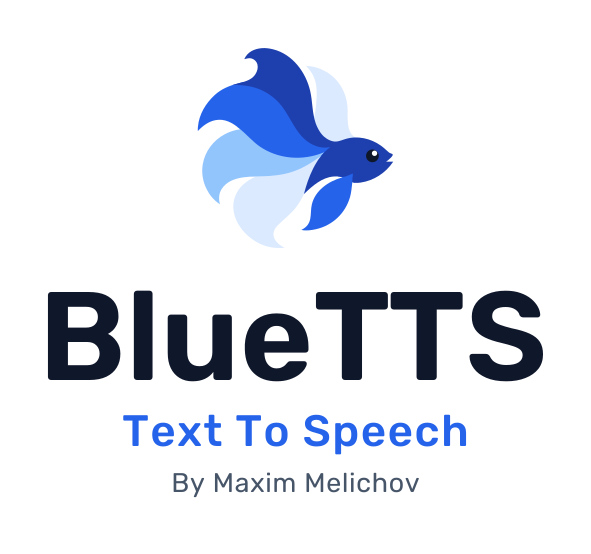

<p align="center">
  <picture>
    <source media="(prefers-color-scheme: dark)" srcset="assets/logo-dark.svg">
    
  </picture>
</p>

<p align="center">
  <b>Multilingual text-to-speech on ONNX Runtime</b><br>
  Hebrew &middot; English &middot; Spanish &middot; Italian &middot; German &middot; Russian &middot; Yiddish
</p>

<p align="center">
  <a href="https://huggingface.co/spaces/notmax123/BlueV3"></a>
  &nbsp;
  <a href="https://bluetts.com/"></a>
</p>

---

## Quick start

```bash
git clone https://github.com/maxmelichov/BlueTTS.git
cd BlueTTS
uv sync
uv run hf download notmax123/BlueV3-onnx --include "onnx/*" --include "voices/*" --include "frontend/*" --local-dir ./bluev3_onnx
uv pip install --no-index --find-links ./bluev3_onnx/frontend polyg2p==0.1.0   # G2P for en / de / es / it / ru
```

Give `--include` once per pattern: with `--include "onnx/*" "voices/*" ...` current `hf` versions skip `onnx/`
without an error. The bundle has polyg2p wheels for Linux x86-64 (glibc >= 2.34) and macOS (Apple Silicon and Intel); the command
above picks the one for your machine. There is no Windows wheel yet: there, Hebrew and Yiddish work, and English,
German, Spanish, Italian and Russian raise `RuntimeError: This release bundle needs polyg2p`.

```python
import soundfile as sf
from blue_onnx import BlueTTS

tts = BlueTTS(onnx_dir="bluev3_onnx/onnx", style_json="voices/noa.json")
samples, sr = tts.synthesize("Hello, this is BlueTTS speaking.", lang="en")
sf.write("out.wav", samples, sr)
```

The bundle sets the operating point itself (8 steps, CFG 4.0, speed 1.0, language tags on).
Speed 1.0 is each voice's calibrated natural reading pace in each language: a voice JSON can carry
`"speed_scale": {"he": 1.077, "en": 1.03, ...}`, and the duration is divided by `speed * speed_scale[lang]`.
Older voice files without `speed_scale` (or a language it does not list) use 1.0, exactly as before.
Numbers, dates, prices and codes are spoken as words automatically (Yiddish: spell numbers out). Mix languages
inline with `<en>…</en>`:

```python
samples, sr = tts.synthesize("Welcome, everyone. <es>Bienvenidos a la presentación.</es>", lang="en")
```

Hebrew grapheme-to-phoneme is [RenikudPlus](https://github.com/maxmelichov/RenikudPlus), with the
weights shipped in the bundle (`frontend/renikud/model.onnx`); English, German, Spanish, Italian
and Russian use polyg2p (wheels in the bundle: Linux x86-64 and macOS); Yiddish uses the bundle's
`frontend/yi`. The bundle runs on `blue_onnx`; `blue_trt` does not
read it yet. Details: [Release bundles](src/blue_onnx/README.md#release-bundles).

## Voice cloning

Speak in the voice of a reference recording (about 10 s of clean speech, any sample rate). The bundle's
`reference_encoder.onnx` does it; no PyTorch needed:

```python
tts = BlueTTS(onnx_dir="bluev3_onnx/onnx", ref_wav="my_voice.wav")
samples, sr = tts.synthesize("Hello, this is my cloned voice.", lang="en")

tts.voice_from_wav("my_voice.wav", save_json="my_voice.json")   # keep it: BlueTTS(style_json="my_voice.json")
```

Full script: [`examples/zero_shot.py`](examples/zero_shot.py). Any sample rate and channel count works (the clip
is mixed to mono and resampled the way the model was trained); only about the first 9 s are read. A voice works
only with the bundle it was made from: voices of `exports/export_new_voice.py` and of blue-onnx-v2 are the v2
architecture and do not work with BlueV3.

### Voice cloning tips

From a small test (method at the end of this section). No listening test was done: the numbers come from
speaker-verification models and pitch tracking.

- **Length: 8-10 s.** Only the first ~9 s are read: a 10 s clip and a 30 s clip give identical voices, so longer
  clips change nothing. Shorter clips are worse: speaker similarity (ECAPA, 4 studio speakers) was 0.53 / 0.59 /
  0.60 / 0.60 from 2 / 4 / 6 / 10 s, and 0.45 / 0.48 / 0.49 / 0.53 for 4 audiobook readers. Clips under 1 s are
  refused. Silence counts toward the 9 s; 4 s of leading silence or 2 s gaps between sentences did not hurt here.
- **Clean, close and full band.** One clean 10 s clip, degraded:

  | reference | similarity (ECAPA) | carried into the output? |
  |---|---|---|
  | clean, 48 kHz | 0.51 | |
  | background music at 10 dB | 0.50 | no, output pauses stay silent |
  | resampled to 16 kHz | 0.46 | |
  | noise at 10 dB SNR | 0.34 | no, output pauses stay silent |
  | clipped (18 dB over full scale) | 0.32 | output is brighter (+3 dB above 4 kHz) |
  | room reverb (RT60 0.7 s) | 0.30 | no clear reverb in the output by our measure |
  | phone band (300-3400 Hz) | 0.26 | yes: the output has no sound above 4 kHz either |

  Noise and reverb don't end up in the output, but they cut similarity from 0.51 to 0.30-0.34 (a different
  speaker scores about 0.13); a phone recording gives a phone-sounding voice. Use the original recording
  (44.1 or 48 kHz), not a phone call or a re-encoded copy. MP3 and other codecs were not tested.
- **What it copies: timbre and pitch level, not delivery.** The same speaker reading "happy" (206 Hz average pitch)
  and "neutral" (130 Hz) gave clones at 200 Hz and 141 Hz. Speaking rate stayed about the same (4.4-5.1 syllables/s)
  whatever the reference, and an expressive reference did not reliably add pitch movement (see
  [Expressiveness](#expressiveness)). A clone from a sad or happy clip also scored lower against the speaker's
  neutral speech (0.28-0.51 versus 0.53-0.60 from a neutral clip), so clone from the delivery you want.
- **The words don't matter.** No transcript is needed, and what is said in the clip has no effect. Put the best
  part of the recording first, since only the first ~9 s are read.
- **Language.** Use a clip in the language you will synthesize when you can (not measured here; every test above
  is English).
- **How close.** Taking a different speaker as 0 % and the same speaker's real speech as 100 %, the 10 s clones
  reached 85 % on the studio speakers and 59 % on the audiobook readers (16 kHz references, held-out speech from
  another chapter); resemblyzer gives about 100 % and 70 %. Recording quality matters more than length beyond 6 s.

How this was measured: 8 English speakers, 4 from Expresso (studio, 48 kHz, CC BY-NC 4.0) and 4 from LibriSpeech
dev-clean (16 kHz, CC BY 4.0); clones from the first 2-30 s of each speaker's speech, 3 sentences each, 8 steps,
fixed seeds; speaker similarity is the cosine between each output and the centroid of 30 held-out real utterances
of the same speaker, with two speaker-verification models (SpeechBrain ECAPA-TDNN and resemblyzer). Pitch is pYIN
on voiced frames. The degraded clips and the reverb are synthetic (noise is pink noise, music is a generated
chord pattern), and everything is English only.

### Expressiveness

There is no emotion or style control. Delivery comes from the voice (or the reference clip) and, a little, from
punctuation. On one sentence with 5 seeds each, pitch movement did not change beyond seed-to-seed variation with
`cfg_scale` 1-8 or 4-32 steps. `?` added some pitch movement for a stock voice but not for a cloned one; `!`
measured the same as `.`; `...` is read as `,`; slower `speed` (0.8) added a little. ALL CAPS changes nothing (the
phonemes are the same), except that a short all-caps word can be spelled out: `WON` is read "W O N". For a livelier
read, pick a livelier stock voice or clone from a lively clip; its pitch level carries over, but how lively the
result is was not consistent in our test.

Very long sentences can sound uneven. Split them with punctuation where a speaker would breathe.

## Streaming

`stream()` yields the audio chunk by chunk, so playback starts after the first chunk instead of after the
whole text ([`examples/stream.py`](examples/stream.py)):

```python
for chunk in tts.stream(long_text, lang="en"):   # mono float32 arrays at tts.sample_rate
    play(chunk)
```

The [OpenAI-compatible server](#openai-compatible-server) streams the same way (`stream_format: "audio"`).

## Speed

BlueTTS makes speech faster than it plays back, on an ordinary CPU, with no GPU needed. Typical results with the default settings (seconds of audio per second of compute, after the model is loaded):

- **Apple M5 laptop:** about 22x (one minute of audio in under 3 seconds)
- **Ryzen 9 desktop:** about 15x
- **Small 2-CPU cloud server:** about 5x
- **In the browser (WebGPU):** 29-46x on an M5

Measure it on your own machine:

```bash
uv run python examples/benchmark.py              # --threads N, --steps N, --precision fp32|int8, --providers ...
```

Tuning, if you need it:

- **Faster at a small quality cost:** `total_step=6` (default is 8).
- **Threads:** `blue_onnx` picks the number of CPUs it can actually use, up to 8. Override it with `ORT_NUM_THREADS`.
- **Precision:** on x86 and ARM Linux a faster int8 copy of the main step model is used automatically, with no measurable loss in word accuracy. Choose with `precision="fp32" | "int8" | "auto"` or `BLUE_ONNX_PRECISION`.
- **Intel CPUs:** OpenVINO is an alternative: `uv sync --extra openvino && uv pip uninstall onnxruntime`, then `BlueTTS(..., providers=["OpenVINOExecutionProvider"])`.

## Used by

- [Subtitld](https://subtitld.org/addons/bluetts): the BlueTTS add-on dubs subtitles offline with BlueV3, including
  voice cloning.

## Documentation

| | |
|---|---|
| [`src/blue_onnx/`](src/blue_onnx/README.md) | **Inference API** — entry points, text normalization, language spans, accelerators |
| [`examples/`](examples/README.md) | Runnable scripts for every feature |
| [`exports/`](exports/README.md) | New voices, ONNX export, TensorRT engines |
| [`training/`](training/README.md) | Dataset prep and the three training stages |

## Install

Requires **Python 3.12+** and [uv](https://docs.astral.sh/uv/).

```bash
git clone https://github.com/maxmelichov/BlueTTS.git
cd BlueTTS
uv sync
```

Optional extras are documented per use case: [accelerators](src/blue_onnx/README.md#accelerators)
(OpenVINO, CUDA), [`--extra export`](exports/README.md) for voice/ONNX export, and
[`--extra tensorrt`](exports/README.md#build-tensorrt-engines).

## OpenAI-compatible server

[`examples/openai_server.py`](examples/openai_server.py) serves BlueTTS behind the OpenAI speech API
(`POST /v1/audio/speech`), so OpenAI clients, Open WebUI and plain curl can use it unchanged. Based on the
server shared by [@MaximS](https://github.com/MaximS) in [#22](https://github.com/maxmelichov/BlueTTS/issues/22).

```bash
uv sync --extra server              # fastapi + uvicorn; mp3 / opus / aac also need ffmpeg on PATH
uv run hf download notmax123/BlueV3-onnx --include "onnx/*" --include "voices/*" --include "frontend/*" --local-dir ./bluev3_onnx
uv run python examples/openai_server.py --bundle bluev3_onnx --host 0.0.0.0 --port 8000
```

```bash
curl http://localhost:8000/v1/audio/speech -H "Content-Type: application/json" \
  -d '{"model": "bluev3", "input": "Hello, how are you today?", "voice": "noa", "response_format": "wav"}' -o speech.wav
```

One engine is loaded at startup (CPU by default; `--providers CUDAExecutionProvider,CPUExecutionProvider` for a
GPU build of ONNX Runtime) and requests are served one synthesis at a time. `--bundle` also reads `BLUE_BUNDLE`;
`--api-key` (or `BLUE_API_KEY`) makes the server require `Authorization: Bearer <key>`, otherwise any key is accepted.

| field | |
|---|---|
| `input` | text, up to 4096 characters |
| `voice` | one of the 15 voices below; OpenAI's names map to fixed voices: `alloy`→`maya`, `echo`→`adam`, `fable`→`daniel`, `onyx`→`david`, `nova`→`noa`, `shimmer`→`lily` |
| `response_format` | `mp3` (default), `wav`, `pcm`, `flac`, `opus`, `aac`. `wav` and `pcm` always work; the others need ffmpeg or a libsndfile that writes them, else 400. `pcm` is 16-bit mono at 24 kHz like OpenAI's (`--pcm-sample-rate 0` for the model's 44.1 kHz) |
| `speed` | 0.25–4.0 |
| `model` | accepted and ignored (`GET /v1/models` lists `bluev3`) |
| `language` | extension: `he`, `en`, `de`, `es`, `it`, `ru`, `yi`. Default: `he` when the text has Hebrew letters, else `en` (Yiddish needs `yi` explicitly) |
| `stream_format` | `audio` (or `"stream": true`) streams `wav` / `pcm` sentence by sentence as chunked transfer; `sse` sends the same bytes as `speech.audio.delta` events. Other formats come back whole |

**Voice markers** (extension): `[name]` in the input switches voice from that point on, e.g.
`"Hello there. [adam] And hello from me. [lily] Hi!"`. Only names of available voices (or the OpenAI
aliases) count as markers; text without markers is read in the request's `voice`, and each segment gets its own
language detection. Inline `<en>…</en>` spans work as in `synthesize`.

Other endpoints: `GET /v1/audio/voices` (voice list), `GET /v1/models`, `GET /health`.

**Open WebUI**: Admin Panel → Settings → Audio → Text-to-Speech engine **OpenAI**, API base URL
`http://<host>:8000/v1` (from a Docker container on the same machine: `http://host.docker.internal:8000/v1`),
any API key (or the `--api-key` value), TTS voice e.g. `noa`, model `bluev3`.

Voices: female `maya`, `noa`, `lily`, `tamar`, `shira`, `yael`, `emma`, `sara`; male `adam`, `daniel`, `david`,
`jonathan`, `ethan`, `michael`, `ariel`. The server reads the bundle's `voices/` and then the repo's `voices/`
(`--voices-dir` to use another directory).

## Models

**Current — BlueV3 `v3.0.1`** (checkpoint `702000`): the text-to-latent EMA at 700k, trained with the RobustSpeechFlow
contrastive loss ([arXiv 2605.22083](https://arxiv.org/abs/2605.22083)), plus 1,500 iterations
of FlowTTS-GRPO reinforcement learning ([arXiv 2606.23190](https://arxiv.org/abs/2606.23190)) and 500 more with a
pause reward, a new duration model (Hebrew paced closer to read speech), and calibrated speed: `speed=1.0` is natural
read-speech pace for every voice and language (`speed_scale` in each voice JSON). v3.0.0 (checkpoint `701500`) stays
on HF under the git tag `v3.0.0`.

| | |
|---|---|
| [notmax123/BlueV3-onnx](https://huggingface.co/notmax123/BlueV3-onnx) | ONNX bundle: `onnx/` (the `blue_onnx` layout + `reference_encoder`), `voices/`, `frontend/` |
| [notmax123/BlueV3](https://huggingface.co/notmax123/BlueV3) | PyTorch checkpoints (text-to-latent `ckpt_step_702000.pt`, duration predictor), latent stats, config, voices |
| [notmax123/blue-codec](https://huggingface.co/notmax123/blue-codec) | the audio autoencoder, one file (`model.safetensors`) |

Languages: Hebrew, English, German, Spanish, Italian, Russian, Yiddish. Operating point: 8 Euler steps,
CFG 4.0, speed 1.0, language tags on.

```python
samples, sr = tts.synthesize("שלום, מה שלומך?", lang="he")
samples, sr = tts.synthesize("Привет, как дела?", lang="ru")
samples, sr = tts.synthesize("גוט מאָרגן, ווי גייט עס?", lang="yi")
```

**Voices.** 15 voice JSONs (LibriTTS-R speakers, CC BY 4.0) in [`voices/`](voices/) and in the bundle's
`voices/` ([list](examples/voices.md)): female `maya`,
`noa`, `lily`, `tamar`, `shira`, `yael`, `emma`, `sara`; male `adam`, `daniel`, `david`, `jonathan`, `ethan`,
`michael`, `ariel`. A voice JSON is valid only for the checkpoint it was exported from; voices of earlier
releases do not work with BlueV3.

**Scores** (unseen test set and unseen voices, 8 steps, CFG 4, both with the v3.0.1 duration model):

| | v3.0.0 | v3.0.1 |
|---|---|---|
| Hebrew phone error rate | 1.81 % | 1.80 % (no change) |
| Hebrew speaker similarity | 0.664 | **0.670** |
| Hebrew DNSMOS OVRL | 3.41 | **3.43** |
| English word error rate | 1.81 % | 1.95 % (no change) |
| English speaker similarity | 0.676 | **0.679** |
| Pause share, he / en / de (read speech 11.4 / 11.0 / 13.4 %) | 8.9 / 8.7 / 8.9 % | 9.6 / 9.6 / 10.0 % |

**Previous — [notmax123/BlueTTS2.5-onnx](https://huggingface.co/notmax123/BlueTTS2.5-onnx)** and
[notmax123/blue-onnx-v2](https://huggingface.co/notmax123/blue-onnx-v2) still load (no `blue_release` section in
their `tts.json`), with the previous voices in [`voices/v2/`](voices/v2/), e.g.
`BlueTTS(onnx_dir="onnx_models", style_json="voices/v2/noa.json")`. The BlueV3 voices in `voices/` carry
`"model": "bluev3-702000"`, and `blue_onnx` refuses them with an older bundle. `blue_onnx.style` and
`examples/zero_shot.py` clone voices with either bundle (see [Voice cloning](#voice-cloning)); a voice
cloned with blue-onnx-v2 works only with blue-onnx-v2.

## Star history

[](https://www.star-history.com/?repos=maxmelichov%2Fbluetts&type=date&legend=top-left)

## Citations

```bibtex
@ARTICLE{2025arXiv250323108K,
       author = {{Kim}, Hyeongju and {Yang}, Jinhyeok and {Yu}, Yechan and {Ji}, Seunghun and {Morton}, Jacob and {Bous}, Frederik and {Byun}, Joon and {Lee}, Juheon},
        title = "{SupertonicTTS: Towards Highly Efficient and Streamlined Text-to-Speech System}",
      journal = {arXiv e-prints},
     keywords = {Audio and Speech Processing, Machine Learning, Sound},
        pages = {arXiv:2503.23108},
}
@article{kim2025training,
  title={Training Flow Matching Models with Reliable Labels via Self-Purification},
  author={Kim, Hyeongju and Yu, Yechan and Yi, June Young and Lee, Juheon},
  journal={arXiv preprint arXiv:2509.19091},
  year={2025}
}
@misc{yi2025robustttstrainingselfpurifying,
      title={Robust TTS Training via Self-Purifying Flow Matching for the WildSpoof 2026 TTS Track},
      author={June Young Yi and Hyeongju Kim and Juheon Lee},
      year={2025},
      eprint={2512.17293},
      archivePrefix={arXiv},
      primaryClass={cs.SD},
      url={https://arxiv.org/abs/2512.17293},
}
@misc{yang2026robustspeechflow,
      title={RobustSpeechFlow: Learning Robust Text-to-Speech Trajectories via Augmentation-based Contrastive Flow Matching},
      author={Jinhyeok Yang and Hyeongju Kim and Yechan Yu and Joon Byun and Frederik Bous and Juheon Lee},
      year={2026},
      eprint={2605.22083},
      archivePrefix={arXiv},
      primaryClass={cs.SD},
      url={https://arxiv.org/abs/2605.22083},
}
@misc{wang2026flowttsgrpo,
      title={FlowTTS-GRPO: Online Reinforcement Learning with Multi-Objective Reward Optimization for Flow-Matching Based Text-to-Speech},
      author={Haoxu Wang and Biao Tian and Weiqin Li and Xiang Lv and Han Zhao and Xiangang Li},
      year={2026},
      eprint={2606.23190},
      archivePrefix={arXiv},
      primaryClass={eess.AS},
      url={https://arxiv.org/abs/2606.23190},
}
```

## License

MIT.

## Voice cloning and responsibility

This software can produce speech that mimics a reference voice. **The maintainers and
contributors are not responsible** for what you do with it — compliance with law, consent
from voice owners, and ethical use are **entirely your responsibility**. Do not use it to
deceive, impersonate without permission, or infringe anyone's rights.
